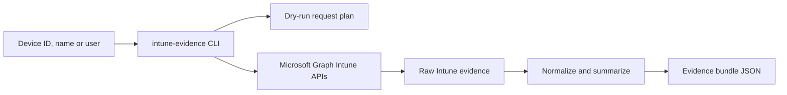

<!-- jr-brand:start -->
<p align="center">
  <a href="https://jannikreinhard.com/">
    
  </a>
</p>
<p align="center">
  <a href="https://jannikreinhard.com/">Website</a> ·
  <a href="https://www.linkedin.com/in/jannik-r/">LinkedIn</a> ·
  <a href="https://x.com/jannik_reinhard">X</a> ·
  <a href="https://www.youtube.com/@jannikreinhard">YouTube</a>
</p>
<!-- jr-brand:end -->

# Intune Evidence CLI

**Type:** Tool or application · **Status:** Community project

## Overview

Agent-friendly Microsoft Intune evidence collection for devices, policies, compliance and apps.

Collect. Normalize. Explain.


Microsoft Intune | Microsoft Graph | Python CLI | Agent Ready

Intune Evidence CLI collects focused Microsoft Intune evidence through Microsoft Graph and returns stable JSON for humans, scripts and AI agents. It is designed for troubleshooting workflows where an agent needs to prove what is assigned, what is compliant, what is stale and which raw Graph requests were used.

The CLI can resolve a managed device by ID, device name or user principal name, normalize the most important device fields, and build an evidence bundle with compliance policy states, configuration states and detected apps.

## Quickstart

```bash
git clone https://github.com/JayRHa/intune-evidence-cli.git
cd intune-evidence-cli
python -m pip install -e .

export MSGRAPH_ACCESS_TOKEN="<access-token>"
intune-evidence device --device-name "WIN-001" --dry-run
intune-evidence bundle --device-id "<managed-device-id>"
```

Use client credentials instead of a prebuilt token:

```bash
export AZURE_TENANT_ID="<tenant-id>"
export AZURE_CLIENT_ID="<app-registration-client-id>"
export AZURE_CLIENT_SECRET="<client-secret>"

intune-evidence user-devices --user alex@example.com
```

## How It Works



## Commands

| Command | Purpose |
| --- | --- |
| `intune-evidence device` | Resolve one Intune managed device and return a normalized summary. |
| `intune-evidence bundle` | Build a device evidence bundle with compliance, configuration and detected app evidence. |
| `intune-evidence user-devices` | List normalized Intune managed devices for a user principal name. |

## Examples

```bash
intune-evidence device --device-name "WIN-001"
intune-evidence device --user alex@example.com --stale-after-days 3
intune-evidence bundle --device-id "<managed-device-id>" --include compliance,configuration
intune-evidence user-devices --user alex@example.com --dry-run
```

## Microsoft Graph Permissions

| Evidence | Graph permission |
| --- | --- |
| Managed devices | `DeviceManagementManagedDevices.Read.All` |
| Compliance states | `DeviceManagementConfiguration.Read.All` |
| Configuration states | `DeviceManagementConfiguration.Read.All` |
| Detected apps | `DeviceManagementManagedDevices.Read.All` |

## Output Contract

All commands write JSON to stdout. `--dry-run` returns the exact Graph request plan, which is useful before giving an automation or AI agent tenant access.

## License

MIT License. See [LICENSE](LICENSE).

<!-- jr-brand-footer:start -->
---

[Articles and guides](https://jannikreinhard.com/) · [Repository index](https://github.com/JayRHa/.github/blob/main/REPOSITORIES.md)
<!-- jr-brand-footer:end -->
